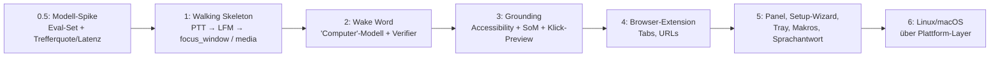

# 🧭 ComputerFlow – Analyse, offene Punkte & Ideen

> Diese Datei sammelt alle Verbesserungsvorschläge und Ideen aus der Konzept-Analyse (Nov. 2026). Was schon erledigt ist, steht in §1. Alles andere ist ein **Vorschlag zur Prüfung** und noch keine feste Entscheidung.

---

## 0. Projekt-Rahmen (Entscheidungen)

| Thema | Entscheidung | Konsequenz |
|---|---|---|
| Zielplattform | **Universell**, kein Zuschnitt auf einen bestimmten PC. Läuft auf Desktop, Laptop und fremden Rechnern. | Plattform-Abstraktion, Hardware-Auto-Detection, keine hartcodierten Pfade/Geräte (siehe §3) |
| Hardware | Beliebig: dGPU (CUDA), iGPU, nur CPU | Das Inferenz-Backend muss portabel sein (siehe §4.4) |
| Nutzung | Primär **privat**, zusätzlich **Open Source** | MIT für den Code. Die LFM-Lizenz ist für nicht-kommerzielle Nutzung unproblematisch, wird aber im README erwähnt. |
| Kommerziell | Nicht geplant | – |

---

## 1. ✅ Bereits erledigt (Fehler & Widersprüche)

- [x] Modell-ID korrigiert: `LiquidAI/LFM3-Omni-2B` (config)
- [x] `transformers>=5.20.2` laut HF-Modellkarte, zusätzlich `torchvision`, `torchcodec`, `librosa`, `soundfile` (requirements, AGENT_SPEC)
- [x] Snapshot-Zeitpunkt vereinheitlicht: Standard ist `both` (Kontext beim Wake-Word + Cursor am Satzende) in README, AGENT_SPEC und config
- [x] `allow_shell_commands` entfernt. Shell-Befehle werden bewusst nicht unterstützt (README, AGENT_SPEC, config).
- [x] `LICENSE` (MIT) angelegt, Hinweis auf die LFM-Modelllizenz im README
- [x] Begriff vereinheitlicht: **Feedback-Chirp (LCARS-Stil)**, config-Key `trigger.feedback_chirp`

---

## 2. ⏳ Offen: Wake Word „Computer“

**Problem:** openWakeWord bringt **kein** vortrainiertes „computer“-Modell mit. Die mitgelieferten Modelle sind u. a. `alexa`, `hey_jarvis` und `hey_mycroft`. AGENT_SPEC §2 und der config-Kommentar (`wake_word`) behaupten aktuell das Gegenteil.

**Optionen:**
1. Eigenes Modell mit dem offiziellen openWakeWord-Colab-Notebook trainieren (synthetische TTS-Daten, ca. 1 h, kein lokales GPU nötig). Dabei **deutsche Aussprachevarianten** mitgeben.
2. Ein Community-Modell nutzen (z. B. aus der Home-Assistant-Wakeword-Sammlung).
3. Zusätzlich einen **Custom Verifier** auf die eigene Stimme trainieren (ca. 10 s Aufnahme). Das reduziert Fehlauslösungen stark.

**Wichtig für Universalität:** Das fertige `.onnx`-Modell gehört ins Repo bzw. in ein Release. Der Verifier ist dagegen **pro Nutzer** und wird in einem Setup-Assistenten erzeugt (siehe §3).

**Weitere Risiken:**
- „Computer“ ist ein häufiges Wort, und Lautsprecher-Audio (Streams, Videos) kann auslösen.
- Gegenmaßnahmen: Verifier, Echo-Cancellation bzw. Abgleich mit dem System-Audio-Loopback, Push-to-Talk als Alternative.

---

## 3. 🌍 Universalität / Portabilität (neu durch die Entscheidung „universell“)

- **Plattform-Abstraktionsschicht:** z. B. `computerflow/platform/{windows,linux,macos}.py` mit einheitlichem Interface (`list_windows`, `focus_window`, `get_ui_elements`, `set_volume`, `send_media_key`, `enable_dpi_awareness`). Der Rest des Codes kennt keine OS-Details.
- **Windows-first, aber sauber abstrahiert:** Windows zuerst vollständig umsetzen, Linux/macOS über dieselben Interfaces nachziehen.
  - **Linux/Wayland:** `mss`, `pyautogui` und globale Hotkeys funktionieren eingeschränkt oder gar nicht. Alternativen: `xdg-desktop-portal` (Screenshots), `ydotool` (Input), AT-SPI (Accessibility). Unter X11 funktioniert vieles direkt.
  - **macOS:** Bildschirmaufnahme- und Bedienungshilfen-Berechtigungen sind nötig. Accessibility über `AXUIElement` (pyobjc).
- **Hardware-Auto-Detection** beim Start: CUDA → Vulkan/DirectML/Metal → CPU. Quantisierung automatisch nach verfügbarem (V)RAM wählen, manuell überschreibbar.
- **Erst-Start-Assistent (Setup-Wizard)** im Web-Panel:
  1. Mikrofon wählen und Pegel testen
  2. Modell herunterladen (mit Fortschrittsanzeige, Speicherort wählbar)
  3. Wake-Word-Empfindlichkeit kalibrieren und den Verifier aufnehmen
  4. Kurzer Probe-Befehl
- **Keine hartcodierten Werte:** Gerätenamen, Pfade und Monitor-Indizes gehören in die config. Pfade über `platformdirs` (z. B. `%APPDATA%\ComputerFlow`, `~/.config/computerflow`), damit config, Modelle und Logs pro Nutzer sauber liegen.
- **Geräte-Profile:** Optional mehrere Profile (z. B. `desktop`, `laptop`), automatisch nach Hostname oder Hardware gewählt.
- **Push-to-Talk-Standardtaste:** CapsLock schaltet die Großschreibung um und muss pro OS unterschiedlich unterdrückt werden. Als portabler Default eignen sich eine Maus-Seitentaste oder `F13`/rechte Strg-Taste, CapsLock bleibt optional.
- **Paketierung:** `pyproject.toml` + `uv` mit optionalen Extras (`[cuda]`, `[cpu]`, `[panel]`). Später eventuell ein Installer bzw. eine portable Version (z. B. PyInstaller/Briefcase).
- **CI:** GitHub Actions mit Tests auf Windows, Linux und macOS (Mock-Modus, ohne Modell).

---

## 4. 🔧 Technische Verbesserungsvorschläge

### 4.1 Grounding über den Accessibility-Baum (wichtigster Punkt)
Ein 2B-VLM trifft kleine Buttons auf hochaufgelösten Screenshots unzuverlässig. Besser ist eine Kombination:
- Die UI-Elemente des aktiven Fensters über die OS-Accessibility-API auslesen: **Windows UI Automation** (`uiautomation`/`pywinauto`), **Linux AT-SPI**, **macOS AXUIElement**. Pro Element: Name, Typ, Bounding-Box.
- Daraus das **Set-of-Marks** erzeugen: nummerierte Badges im Bild **und** eine Textliste für das Modell (`[12] Button "Suchen"`).
- Das Modell antwortet mit `element_id: 12`, und der Klickpunkt wird exakt aus der Bounding-Box berechnet.
- `x_norm/y_norm` bleibt der Fallback (Spiele, Canvas, manche Electron-Apps).

→ `som_overlay.py` wird damit von einer Option in Phase 5 zur **Kernkomponente**.

### 4.2 Browser-Tabs (Beispiel „Twitch-Tab von Papaplatte“)
`pywinctl` sieht nur Fenster bzw. den **aktiven** Tab. Inaktive Tabs sind für das OS unsichtbar.
- **Empfehlung:** eine kleine **Browser-Extension** (Chromium-Familie + Firefox per WebExtension-API), die per WebSocket mit dem lokalen Panel spricht. Sie liefert Tabs (Titel/URL) und kann sie fokussieren, öffnen und schließen.
- Neue Action `focus_tab(query)`, neues Modul `computerflow/integrations/browser/`.
- Fallbacks: Chrome DevTools Protocol (`--remote-debugging-port`) oder per Vision auf die Tableiste klicken.

### 4.3 Text-Kontext & zweistufiges Routing
- Bei jedem Request zusätzlich als Text mitsenden: Titel des aktiven Fensters, offene Fenster, Browser-Tabs, Lautstärke und Mediastatus. Das kostet fast nichts und hilft dem Modell stark.
- **Zweistufig:**
  1. Nur Audio + Kontext-Text → direkte Aktion oder `needs_vision: true`
  2. Nur bei Bedarf wird das Bild verarbeitet.

  Befehle wie „lauter“, „pause“ oder „wechsle zu Discord“ brauchen keinen Screenshot und werden dadurch deutlich schneller.

### 4.4 Inferenz-Backend entkoppeln (wichtig für Universalität)
- `torch` + `transformers` sind mehrere GB groß. `int4` braucht `bitsandbytes` (fehlt in den requirements, unter Windows/macOS problematisch). `torch-directml` wird kaum gepflegt.
- **Empfehlung:** `lfm_client.py` spricht eine **lokale HTTP-API** an, z. B. den **llama.cpp-Server** (GGUF, CUDA/Vulkan/Metal/CPU, läuft auf praktisch jeder Hardware) oder **Ollama**. Bitte prüfen, ob dort Audio-Input für LFM3-Omni unterstützt wird. `transformers` bleibt als alternatives Backend erhalten.
- Vorteile: Das Modell bleibt im (V)RAM geladen, die App startet schneller, das Modell lässt sich leicht tauschen und die Installation wird kleiner.
- **Constrained Decoding** (JSON-Schema/Grammar) ist bei einem 2B-Modell praktisch Pflicht, sonst kommt regelmäßig kaputtes JSON zurück.
- Prüfen, in welchem **Koordinatenformat LFM3 trainiert wurde**, und genau dieses nutzen bzw. intern auf `0..1000` umrechnen.

### 4.5 Action-Chaining & veraltete Koordinaten
Nach einem Klick ändert sich die UI, und weitere Koordinaten aus demselben Screenshot stimmen dann nicht mehr.
- Regel: **höchstens eine positionsbasierte Aktion pro Kette**, danach nur noch `type_text`/`hotkey`.
- Oder eine **Observe-Act-Schleife**: nach jedem Klick neuer Snapshot und neuer Modellaufruf, begrenzt durch `max_steps`.

### 4.6 Sicherheit
- **Bestätigungspflicht deterministisch im Executor** festlegen (nach Action-Typ, Zielfenster und Schlüsselwörtern wie „löschen“, „senden“, „kaufen“). `requires_confirmation` vom Modell ist höchstens ein zusätzliches Signal.
- **Prompt-Injection über den Bildschirm:** Bildschirminhalt ist immer *Daten*, nie *Anweisung*. Das gehört so in den System-Prompt.
- **Not-Aus:** globaler Hotkey und „Computer, stopp“ brechen laufende Ketten sofort ab. `pyautogui.FAILSAFE` bleibt aktiv.
- **Web-Panel absichern:** Jede Webseite kann Requests an `127.0.0.1:8088` schicken (CSRF/DNS-Rebinding). Daher ein zufälliges Session-Token, eine `Host`-Header-Prüfung und ein strenges CORS. Das gilt auch für die WebSocket-Verbindung der Browser-Extension.
- `open_url` nur für `http(s)`. `launch_app` über eine **Alias-Liste** pro Gerät statt freier Strings.
- **Datenschutz:** Aufbewahrungsgrenze für Debug-Snapshots (z. B. 50 Stück / 24 h) und eine Fenster-Blacklist (Passwortmanager, Banking), bei der nie ein Snapshot gemacht wird.

### 4.7 Kleinere Punkte
- **DPI (Windows):** `SetProcessDpiAwarenessContext(-4)` (Per-Monitor v2) statt `SetProcessDpiAwareness(2)`. Gemischte Skalierungen und negative Monitor-Offsets testen.
- **Lautstärke:** Mit Media-Keys geht nur „lauter/leiser“. Für genaue Werte („auf 30 %“) gibt es `pycaw` (Windows), `pactl`/`wpctl` (Linux) und `osascript` (macOS).
- **Sprache:** Prüfen, wie gut LFM3-Omni **deutsche Spracheingabe** versteht. Den System-Prompt eventuell auf Englisch halten und nur die Antworten auf Deutsch geben lassen.
- **Abhängigkeiten pinnen** bzw. Obergrenzen setzen (über `uv.lock`).

---

## 5. 💡 Ergänzende Feature-Ideen

| Idee | Nutzen |
|---|---|
| 🗣️ **Sprachantwort mit LFM3-Omni selbst** (das Modell kann Sprache ausgeben) | Star-Trek-Feeling ohne zusätzliches TTS |
| 🎯 **Ziel-Vorschau vor dem Klick**: LCARS-Overlay markiert das Ziel ~400 ms vorher, abbrechbar | Vertrauen, Sicherheit, Debugging |
| ✅ **Sprachbestätigung**: „Computer, bestätigen“ / „Energie!“ | Freihändig, thematisch passend |
| 🧠 **Kurzzeitgedächtnis**: die letzten 2–3 Befehle als Kontext („…und jetzt lauter“, „nein, der andere“) | Natürlichere Bedienung |
| ⚡ **Makros / Szenen** in YAML („Computer, Arbeitsmodus“) | Großer Alltagsnutzen, deterministisch |
| 📖 **„Computer, was steht hier?“**: Bildschirm vorlesen bzw. zusammenfassen | Barrierefreiheit als starker Open-Source-Use-Case |
| ⌨️ **Diktiermodus** | Naheliegende Erweiterung der Audio-Pipeline |
| 🧩 **Plugin-/Skill-System** (Browser, Spotify, Discord, OBS, Home Assistant) | Erweiterbar, community-tauglich |
| 🔁 **Lernen aus Korrekturen**: Fehlklicks im Panel markieren → Eval-Datensatz → später eventuell LoRA-Fine-Tuning | Die Trefferquote wird mit der Zeit besser |

---

## 6. 🗺️ Vorschlag für eine angepasste Roadmap

Erst das größte Risiko (die Modellqualität) klären, dann einen dünnen End-to-End-Durchstich bauen, und erst danach in die Breite gehen.

- **Phase 0.5:** `tests/eval/` mit ca. 30 Fällen (WAV + PNG + erwartete Action) und ein Skript, das Trefferquote und Latenz misst, idealerweise auf Desktop **und** Laptop. Später dient das Set als Regressionstest für Prompt- und Modell-Updates.
- **Phase 1:** Push-to-Talk statt Wake Word, nur native Aktionen. Danach ist das Tool schon im Alltag nutzbar.

---

## 7. ❓ Noch offene Fragen

1. **Browser-Extension:** Ist sie als optionale Komponente okay? Für Tab-Befehle ist sie praktisch nötig.
2. **Inferenz-Backend:** llama.cpp/Ollama als Standard und `transformers` als Alternative, oder umgekehrt?
3. **Wake Word:** Selbst trainieren oder ein Community-Modell nutzen (siehe §2)?
